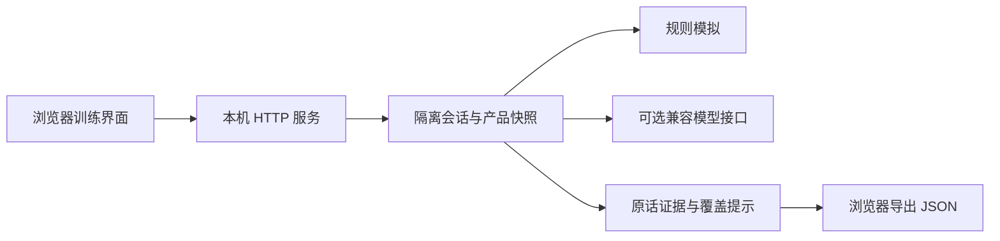

# 项目说明书：销售对练实验室

## 一句话介绍

一个支持 TOB 合作开拓与 TOC 客户销售的沟通训练 Demo，用虚构场景串起“选场景—角色对话—证据复盘—记录导出”，默认无需密钥即可体验。

## 背景与目标

销售训练需要反复练习，但真实客户不适合承担试错成本。企业合作与消费者咨询又有不同的决策逻辑：前者重视组织协同、责任与试点，后者重视个人需求、服务边界与自主选择。

本项目将两类训练整合为一个轻量产品体验，目标是展示场景建模、对话状态管理、可解释反馈与公开数据管理的设计和实现。它是求职作品 Demo，不是已经投入生产的商业系统。

## 用户与核心流程

| 用户 | 训练任务 | 观察重点 |
| --- | --- | --- |
| 合作顾问 | 面对虚构门店店长或运营负责人 | 顾虑澄清、责任分工、试点推进 |
| 服务顾问 | 面对虚构车主 | 需求探索、服务匹配、异议回应、自主决策 |
| 面试评审者 | 快速体验两类场景并查看代码 | 产品闭环、工程边界、可运行性 |

选择场景与产品后开始对话；常规模式下用户扮演顾问，互换模式下用户扮演客户。结束后显示复盘证据，可将当前记录下载为 JSON。每次重新开始都会隔离前一轮历史。

## 功能范围

- 四个虚构场景：门店初访、合作方案评审、车主预算顾虑、信任建立。
- 两个虚构服务产品，分别维护事实、演示价格与不包含的内容。
- 两种难度与场景种子，控制规则模拟的追问顺序。
- 模拟回复和可选真实模型调用；模型配置只在服务端读取。
- 五维关键词覆盖提示，引用用户原话而不是输出未经验证的能力分。
- 角色互换时仅回顾对话，不对客户角色套用顾问量表。
- 公开文件扫描、源码打包、自动化测试与持续集成配置。

## 技术实现

前端使用原生 HTML、CSS 和 JavaScript，后端使用 Python 3.12 标准库，无需第三方依赖即可启动。场景、产品、提示词与应用逻辑分目录维护。

后端负责校验场景和产品标识、管理内存会话、调用对话引擎及生成复盘结果。模型请求失败时不提交该轮消息，保留重试空间。浏览器只调用本机后端，不接收模型密钥。

## 公开数据与隐私边界

本版本独立新建演示资料，不携带真实客户、内部案例、合同、业务政策、原始录音或模型凭证。产品价格和角色背景仅用于训练，不对应实际商业报价。

扫描器检查文件类型和部分敏感文本模式，不能替代人工语义审查。用户自行输入的内容也可能带有个人信息，导出记录或使用外部模型前应自行检查。

## 验证与限制

本机已通过 11 项自动化测试，并完成浏览器的 TOB 对话与复盘、TOC 角色互换和产品边界回应检查。具体范围见 [验收记录](validation.md)。

默认对话是规则模拟；关键词命中可能包含无关表达，因此不能作为正式员工考核依据。真实模型接口尚未进行付费服务实测。当前没有登录、持久化存储、语音、多人对练或模型自动评分，也不适合直接暴露到公网。

## 求职介绍参考

### 简历简版

构建支持 TOB/TOC 双场景的销售沟通训练 Demo，完成场景配置、角色对话、证据复盘与记录导出闭环；通过独立产品快照和会话隔离控制上下文，提供无密钥模拟模式与服务端模型适配，并建立公开资料扫描及自动化测试流程。

### 面试口述版

这个作品解决的是“如何把不同类型的销售沟通训练放进统一体验”。我保留了企业合作和消费者销售各自的目标与角色，共用对话和复盘流程。为了让面试者能够直接体验，默认提供无密钥的规则模拟；同时在架构上预留真实模型接入。复盘引用用户原话并明确标注规则局限，避免用看似精确的分数夸大能力。公开版使用独立虚构资料，并通过测试和发布扫描控制交付范围。

请根据本人实际参与情况调整第一人称描述，不添加未经验证的业务提升数据或上线规模。
